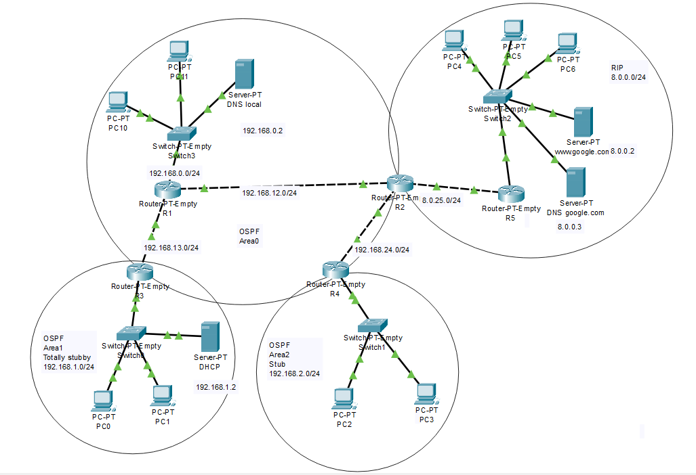

# Network Infrastructure & Routing

A university networking project developed using **Cisco Packet Tracer**, focusing on routing protocols, network services, and access control.

## Network Topology

The network consists of five interconnected routers, multiple switches, end devices, and dedicated servers. It is divided into OSPF and RIP routing domains.

The OSPF domain consists of three areas:
- **Area 0 (Backbone)** – Core network connecting the OSPF routers.
- **Area 1 (Totally Stubby)** – Connected through the area border router R3.
- **Area 2 (Stub)** – Connected through the area border router R4.

Router R2 connects the OSPF and RIP domains and performs route redistribution between them.

## Network Configuration

### IP Addressing & DHCP

- Configured IPv4 addressing and subnet masks for routers, servers, and end devices.
- Configured a DHCP server in OSPF Area 1 to dynamically assign network parameters to local hosts.
- Configured router R5 as a DHCP server for devices in the RIP segment.
- Defined DHCP address exclusions to prevent allocation of reserved addresses.
- Configured default gateways and DNS server addresses.

### Dynamic Routing

- Implemented **OSPF** across three areas with different area types.
- Configured **RIPv2** between routers R2 and R5.
- Implemented bidirectional route redistribution between OSPF and RIP.
- Configured redistribution metrics to support connectivity between both routing domains.

### DNS & Network Services

- Configured a local DNS server in OSPF Area 0.
- Configured DNS resolution for the simulated `google.com` domain through a DNS server in the RIP segment.
- Configured a web server accessible through DNS resolution.
- Enabled remote router management using **Telnet**.

### Access Control Lists (ACLs)

Configured ACL rules on router R5 to restrict traffic to selected network services:

- Permit DNS queries to the DNS server.
- Restrict access to the web server to HTTP and ICMP Echo Request traffic.
- Allow ICMP Echo Requests to devices in the RIP segment, excluding the DNS server.

## Testing & Verification

The network was tested in Cisco Packet Tracer to verify:

- End-to-end connectivity between devices in different subnets.
- Routing between OSPF areas.
- Communication between OSPF and RIP domains.
- Dynamic IP address assignment through DHCP.
- DNS resolution and access to the simulated web server.
- Remote router access through Telnet.
- Traffic filtering based on ACL rules.

## Tools & Technologies

- **Cisco Packet Tracer**
- IPv4 Addressing & Subnetting
- OSPF (Multi-Area)
- RIPv2
- Route Redistribution
- DHCP & DNS
- Access Control Lists (ACLs)
- Telnet
- ICMP

## Project File

The complete network topology and device configurations are available in the `topology/` directory as a Cisco Packet Tracer project file (`.pkt`).

The project can be opened and examined using Cisco Packet Tracer.

## Author

**Stefan Bozic** — [GitHub](https://github.com/stefanbozic78)
